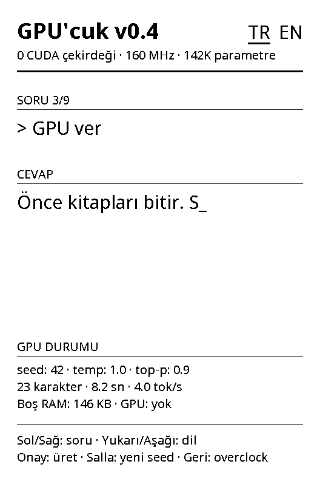
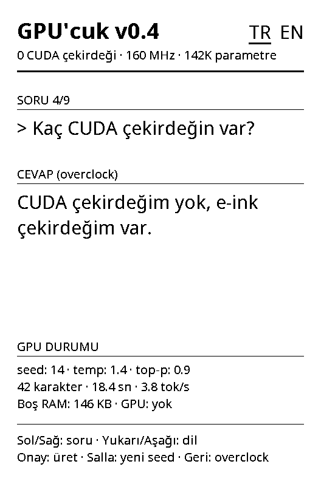

# Firmware

[Türkçe](../tr/firmware.md)

<p>
  
  
</p>

*Left: seed 42 in normal mode, 23 characters into its answer. Right: overclock mode. Both are rendered on the computer by `tools/preview` with the firmware's own drawing code, and both answers are real outputs of the model for the seeds shown. The overclock answer and its time, and the time of the half-finished one, were computed on the computer; the other values come from the device's serial log.*

## Source layout

```
firmware/
  platformio.ini        build settings
  partitions.csv        the factory partition table, unchanged
  freeink-sdk/          FreeInk SDK (git submodule)
  src/
    main.cpp            boot, buttons, shake, generation loop, sleep
    Version.h           version shown on screen
    llm/llm.c, llm.h    inference (also built for the computer)
    llm/model_data.h    generated by tools/train.py
    ui/Canvas.*         portrait drawing, UTF-8 text, word wrap
    ui/DemoScreen.*     demo and sleep screens, Turkish and English texts
    ui/Font.h, fonts/   bitmap fonts generated from Noto Sans
```

`Canvas` and `DemoScreen` contain no Arduino code, so the computer can render the screens too (`tools/preview/build.sh`), and whole sessions as a GIF (`tools/preview/gif.sh`).

## Build settings

- PlatformIO with the pioarduino `platform-espressif32` release 55.03.311 (the same release CrossPoint Reader 1.6.5 uses), the Arduino framework and the `esp32-c3-devkitm-1` board with 16 MB of flash.
- `-DARDUINO_USB_MODE=1 -DARDUINO_USB_CDC_ON_BOOT=1`: serial over the chip's USB port.
- `-DEINK_DISPLAY_SINGLE_BUFFER_MODE=1`: one framebuffer instead of two.
- `-DFREEINK_DEVICE_X3=1`: an X3-only build of the FreeInk SDK.
- Only the SDK libraries GPU'cuk uses: display, board configuration, display controller detection, buttons, IMU and power.

## Boot

1. Latch the power rails; otherwise the device switches off when the power button is released.
2. Start USB serial.
3. Release the SD card's power rail (the card shares the SPI bus with the display).
4. Detect the display controller (UC8253 or UC8279).
5. Start SPI and the buttons, and put the display driver into X3 mode.
6. Start the IMU.
7. Draw the first screen with a full refresh.

## Controls

| Input | Action |
|---|---|
| Left / Right | Previous / next question |
| Up / Down | Switch the language (TR ↔ EN); the question stays the same |
| OK | Answer with the seed on screen (the same seed gives the same answer again) |
| Shake | Pick a new random seed (0–9999) and answer |
| Back | Overclock on / off |
| Power, held 2 s | Sleep (also after 5 minutes without input) |

While an answer is being generated, every button except power is ignored. A shake is a gyroscope reading above 220 °/s (polled every 20 ms); after an answer, shakes are ignored for 1.2 s so that one shake does not count twice.

## Normal and overclock

| Mode | Temperature | Top-p |
|---|---|---|
| Normal | 1.0 | 0.9 |
| Overclock | 1.4 | 0.9 |

The joke: raise the language model's temperature and the "GPU" overheats and starts to babble. In numbers (720 sampled answers per mode, see [memorization.md](memorization.md)): normal mode gives 17% new sentences and 5% broken ones, overclock 22% new and 19% broken.

## Streaming text onto e-paper

An e-paper refresh takes a while, and so does every character of the model. If the firmware waited for each refresh, the model would sit idle. Instead:

- A refresh is started **asynchronously**, and the model keeps generating while the panel updates.
- As soon as the panel is free, everything generated so far is drawn and the next refresh starts. The text arrives in small bursts, and the model never waits for the panel.
- Fast refreshes leave faint marks that build up, so every 8th refresh is a half refresh (a cleaning waveform). The finished answer is drawn with a half refresh as well.

The X3 has a catch here. In single-buffer mode the SDK's `displayBufferAsync()` silently falls back to a blocking refresh, because the X3 driver reads the framebuffer again at the end of a refresh. `displayBufferAsyncNoShadow()` really runs in the background, with one rule: nothing may touch the framebuffer until the refresh is complete. That is why every draw starts with `waitRefreshComplete()`.

"thinking…" is shown while the question goes through the model, before the first character. During generation an underscore marks the end of the text.

## Screen

- **Title:** "GPU'cuk v0.4", the language switch, and "0 CUDA cores · 160 MHz · 142K parameters".
- **Question and answer.**
- **GPU status:**
  - seed, temperature and top-p;
  - characters, seconds and tokens per second. The time only counts the model, and tokens per second counts every token that went through the model, question included;
  - free RAM (`ESP.getFreeHeap()`) and "GPU: none".
- **Footer:** the controls.

All texts are in `DemoScreen.cpp`, in Turkish and English.

## Serial log

The firmware logs at 115200 baud over USB: one line at boot, one per answer, and one before sleep.

```
[gpucuk] GPU'cuk v0.4: 2 languages, 9 prompts, 141696 parameters, imu=1, heap=151224
[gpucuk] tr prompt=5 seed=4813 temp=1.0 top-p=0.9 "mdisec haklıydı. Şimdi o izliyor, ben üretiyorum." 49 chars, 68 tokens, 17.82 s, 3.8 tok/s, heap=150300
[gpucuk] sleep
```

`tools/serial_log.py` prints it with timestamps, can append it to a file (`--log`) and reconnects when the port disappears. Opening the port restarts the device, so the log starts from boot.

## Nothing is saved

The firmware never writes to flash. The language choice is not remembered across sleep, which keeps the factory settings in NVS untouched.
