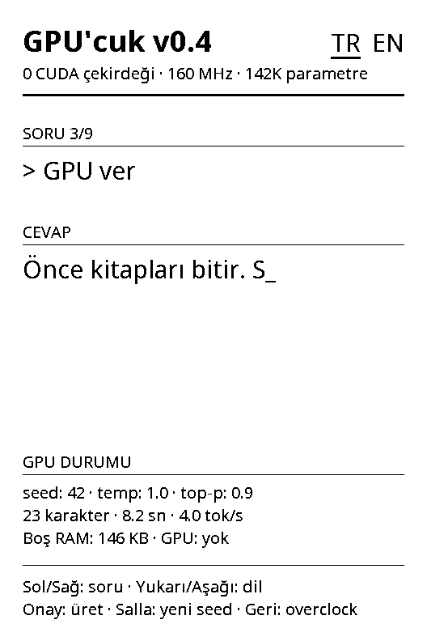
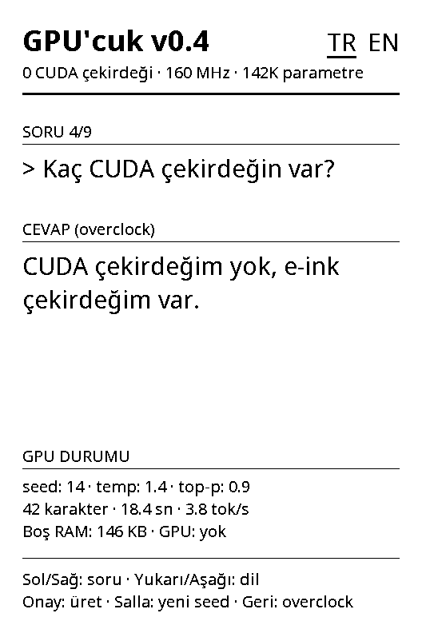

# Firmware

[English](../en/firmware.md)

<p>
  
  
</p>

*Solda: normal modda seed 42, cevabın 23. karakterinde. Sağda: overclock modu. İkisi de bilgisayarda, `tools/preview` ile ve firmware'in kendi çizim koduyla çizildi; iki cevap da modelin, gösterilen seed için verdiği gerçek cevap. Overclock cevabı ile süresi ve yarım cevabın süresi bilgisayarda hesaplandı; diğer değerler cihazın seri logundan.*

## Dosya yapısı

```
firmware/
  platformio.ini        derleme ayarları
  partitions.csv        fabrika bölüm tablosu, değiştirilmeden
  freeink-sdk/          FreeInk SDK (git submodule)
  src/
    main.cpp            açılış, tuşlar, sallama, üretim döngüsü, uyku
    Version.h           ekranda görünen sürüm
    llm/llm.c, llm.h    inference (bilgisayar için de derleniyor)
    llm/model_data.h    tools/train.py çıktısı
    ui/Canvas.*         dikey çizim, UTF-8 metin, satır kaydırma
    ui/DemoScreen.*     demo ve uyku ekranları, Türkçe ve İngilizce metinler
    ui/Font.h, fonts/   Noto Sans'tan üretilmiş bitmap fontlar
```

`Canvas` ve `DemoScreen` Arduino kodu içermiyor; bu sayede ekranlar bilgisayarda da çizilebiliyor (`tools/preview/build.sh`), bütün bir oturum da GIF olarak (`tools/preview/gif.sh`).

## Derleme ayarları

- PlatformIO, pioarduino `platform-espressif32` 55.03.311 sürümü (CrossPoint Reader 1.6.5'in kullandığı sürüm), Arduino framework'ü ve 16 MB flash'lı `esp32-c3-devkitm-1` kartı.
- `-DARDUINO_USB_MODE=1 -DARDUINO_USB_CDC_ON_BOOT=1`: çipin USB portu üzerinden seri bağlantı.
- `-DEINK_DISPLAY_SINGLE_BUFFER_MODE=1`: iki yerine tek framebuffer.
- `-DFREEINK_DEVICE_X3=1`: FreeInk SDK'nın yalnızca X3 için derlenmesi.
- SDK'dan yalnızca GPU'cuk'un kullandığı kütüphaneler: ekran, kart ayarları, ekran denetleyicisi tespiti, tuşlar, IMU ve güç.

## Açılış

1. Güç beslemesini açık tut; tutulmazsa güç tuşu bırakılınca cihaz kapanıyor.
2. USB seri bağlantısını başlat.
3. SD kartın besleme hattını aç (kart, ekranla aynı SPI hattını kullanıyor).
4. Ekran denetleyicisini bul (UC8253 ya da UC8279).
5. SPI'yi ve tuşları başlat, ekran sürücüsünü X3 moduna al.
6. IMU'yu başlat.
7. İlk ekranı tam yenilemeyle çiz.

## Tuşlar

| Giriş | İşlev |
|---|---|
| Sol / Sağ | Önceki / sonraki soru |
| Yukarı / Aşağı | Dili değiştir (TR ↔ EN); soru aynı kalır |
| Onay | Ekrandaki seed ile cevap üret (aynı seed aynı cevabı tekrar verir) |
| Salla | Yeni bir rastgele seed seç (0–9999) ve cevap üret |
| Geri | Overclock aç / kapa |
| Güç, 2 sn basılı | Uyku (5 dakika hiçbir tuşa basılmazsa da) |

Cevap üretilirken güç dışındaki tuşlar yok sayılıyor. Jiroskop 220 °/s'nin üstünde bir değer okuyunca sallama sayılıyor (20 ms'de bir okunuyor). Bir cevaptan sonraki 1,2 saniye boyunca yeni sallama dikkate alınmıyor; böylece tek sallama iki cevap başlatmıyor.

## Normal ve overclock

| Mod | Temperature | Top-p |
|---|---|---|
| Normal | 1,0 | 0,9 |
| Overclock | 1,4 | 0,9 |

Espri şu: temperature, yani modelin "sıcaklığı" artınca "GPU" ısınıyor ve saçmalamaya başlıyor. Sayılarla (her modda 720 örnek cevap, bkz. [memorization.md](memorization.md)): normal modda cevapların %17'si yeni cümle, %5'i bozuk; overclock'ta %22'si yeni, %19'u bozuk.

## Metni e-ink ekranda canlı göstermek

E-ink ekranın yenilenmesi zaman alıyor, modelin her karakteri de öyle. Firmware her yenilemeyi bekleseydi model boşta kalırdı. Bunun yerine:

- Yenileme **arka planda** başlatılıyor ve panel güncellenirken model üretmeye devam ediyor.
- Yenileme biter bitmez o ana kadar üretilen her şey çiziliyor ve sıradaki yenileme başlıyor. Metin küçük parçalar halinde geliyor ve model paneli hiç beklemiyor.
- Hızlı yenilemeler biriken hafif izler bırakıyor; bu yüzden her 8. yenileme yarım yenileme (iz temizleyen dalga formu). Biten cevap da yarım yenilemeyle çiziliyor.

X3'te burada bir tuzak var. Tek tampon modunda SDK'nın `displayBufferAsync()` fonksiyonu, adına rağmen sessizce yenilemenin bitmesini bekliyor, çünkü X3 sürücüsü yenilemenin sonunda framebuffer'ı yeniden okuyor. `displayBufferAsyncNoShadow()` gerçekten arka planda çalışıyor, tek bir kuralla: yenileme bitene kadar framebuffer'a dokunulmayacak. Her çizimin `waitRefreshComplete()` ile başlamasının nedeni bu.

Soru modelden geçerken, ilk karakterden önce "düşünüyor…" görünüyor. Üretim sürerken metnin sonunda bir alt çizgi duruyor.

## Ekran

- **Başlık:** "GPU'cuk v0.4", dil seçimi ve "0 CUDA çekirdeği · 160 MHz · 142K parametre".
- **Soru ve cevap.**
- **GPU durumu:**
  - seed, temperature ve top-p;
  - karakter sayısı, saniye ve tok/s. Süre yalnızca modelin harcadığı zamanı gösteriyor; tok/s ise soru dahil modelden geçen bütün token'ları sayıyor;
  - boş RAM (`ESP.getFreeHeap()`) ve "GPU: yok".
- **Alt bilgi:** tuşlar.

Bütün metinler `DemoScreen.cpp` içinde, Türkçe ve İngilizce.

## Seri log

Firmware USB üzerinden 115200 baud'da log yazıyor: açılışta bir satır, her cevap için bir satır ve uykudan önce bir satır.

```
[gpucuk] GPU'cuk v0.4: 2 languages, 9 prompts, 141696 parameters, imu=1, heap=151224
[gpucuk] tr prompt=5 seed=4813 temp=1.0 top-p=0.9 "mdisec haklıydı. Şimdi o izliyor, ben üretiyorum." 49 chars, 68 tokens, 17.82 s, 3.8 tok/s, heap=150300
[gpucuk] sleep
```

`tools/serial_log.py` logu zaman damgasıyla yazdırıyor, bir dosyaya ekleyebiliyor (`--log`) ve port kaybolunca yeniden bağlanıyor. Portu açmak cihazı yeniden başlattığı için log açılıştan başlıyor.

## Hiçbir şey kaydedilmiyor

Firmware flash'a hiç yazmıyor. Dil seçimi uykudan sonra hatırlanmıyor; böylece NVS'teki fabrika ayarlarına dokunulmuyor.
